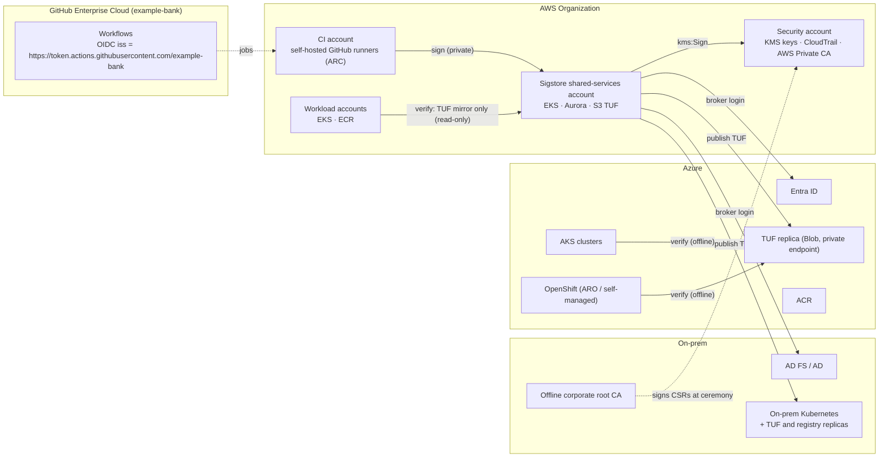
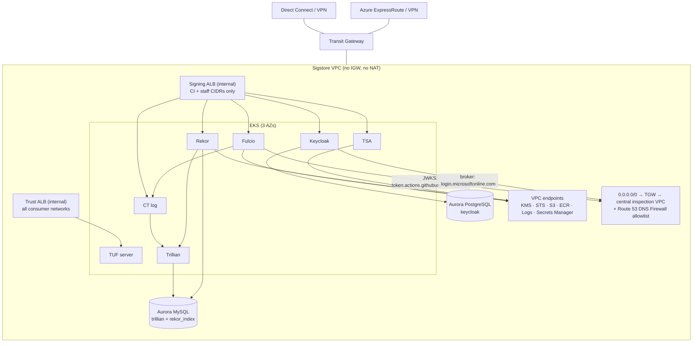
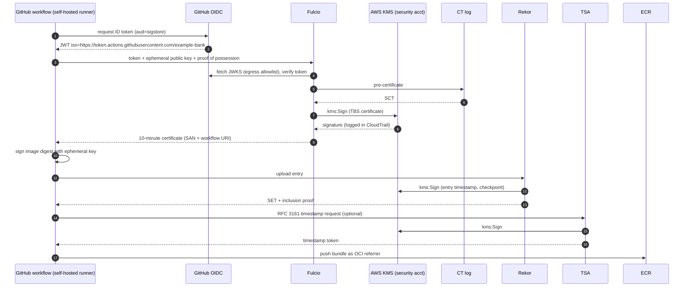

# 01 Architecture

## 1. Context

The only connections that must exist at **signing** time are runner → Sigstore platform, and Sigstore platform → KMS and identity providers. **Verification** needs a TUF replica and the registry, both of which can live next to each cluster.

## 2. AWS accounts

| Account | Contents | Who can change it |
|---|---|---|
| **Security / PKI** (`111111111111`) | KMS keys for Fulcio CA, Rekor, TSA and TUF online roles; AWS Private CA subordinate for TLS; CloudTrail organisation trail destination | Security team only, via pipeline with two-person approval |
| **Sigstore shared services** (`222222222222` prod, separate dev and staging accounts) | VPC, EKS, Aurora MySQL (Trillian, Rekor index), Aurora PostgreSQL (Keycloak), S3 TUF bucket, Route 53 private zone | Platform team via GitOps |
| **CI** | GitHub Actions Runner Controller (ARC) on EKS, ECR pull-through cache | DevOps platform team |
| **Workload accounts** | Application EKS clusters, ECR repositories | App platform teams; Kyverno policy from central repo |

Cross-account access into the security account is limited to these grants:

| Principal | Grant | Key / resource |
|---|---|---|
| `fulcio`, `rekor`, `tsa` IRSA roles (Sigstore account) | `kms:Sign`, `kms:GetPublicKey`, `kms:DescribeKey` | exactly one key each: `fulcio-ca`, `rekor`, `tsa` ([ADR-0011](../../docs/adr/0011-irsa-for-kms.md)) |
| `ctlog` IRSA role | `secretsmanager:GetSecretValue`, `kms:Decrypt` | the CT key secret and its symmetric KMS key |
| `tuf-publisher` role (in the security account itself; listed for completeness) | `kms:Sign`; cross-account `s3:PutObject` into the Sigstore account | `tuf-online` key; TUF bucket (its bucket policy denies writes from any other principal) |
| `sigstore-ceremony` role (MFA, ceremony only) | `kms:GetPublicKey` on all signing keys; `kms:Sign` | `fulcio-ca` and `tsa`, for the two CSRs |

## 3. Network

| Flow | Source → destination | Port | Notes |
|---|---|---|---|
| Sign | Runners, staff laptops → signing ALB | 443 | Route 53 private zone `sigstore.corp.example`, shared with CI and workload VPCs; Route 53 Resolver inbound endpoints for on-prem and Azure DNS forwarding |
| Token verification | Fulcio → GitHub OIDC JWKS | 443 | Egress allowlist: `token.actions.githubusercontent.com` |
| Federation | Keycloak → Entra ID | 443 | Egress allowlist: `login.microsoftonline.com` only. Entra's discovery document advertises a userinfo endpoint on `graph.microsoft.com`, which Keycloak would call; the `entra` identity provider therefore sets *Disable user info* (`disableUserInfo`) and the Entra app registration emits the `email` optional claim in the ID token (`enterprise/helm/manifests/keycloak/realm-staff.yaml`). Allow Graph only if userinfo is turned back on |
| Federation | Keycloak → AD FS | 443 | Over Direct Connect |
| KMS | Fulcio, Rekor, TSA → KMS | 443 | Interface VPC endpoint; cross-account key policy |
| TUF publish | Publisher job → S3, Azure Blob, on-prem | 443 | Signed metadata; replicas are read-only for consumers |
| Verify | Consumer clusters → registry, nearest TUF replica | 443 | Azure and on-prem clusters never connect to the Sigstore VPC. AWS workload networks may reach only the **trust ALB** (`tuf.sigstore.corp.example`, static read-only files). The signing ALB's security group admits only CI runner and staff CIDRs, so workload networks cannot reach Fulcio, Rekor or the TSA (a security group cannot filter by host name, hence two ALBs) |

No Sigstore endpoint is published to the internet. Signing jobs run on self-hosted runners (ARC) in the CI account, which sit on the private network by design. GitHub-hosted runners with GHEC Azure private networking could also reach the endpoints over ExpressRoute; that option was not chosen because it adds an Azure network dependency to every signature ([ADR-0009](../../docs/adr/0009-self-hosted-runners.md)).

## 4. Components and versions

| Component | Version (pinned) | Runs as | State |
|---|---|---|---|
| Fulcio | v1.9.0 (chart `sigstore/fulcio` 2.11.4) | 3 replicas, `kmsca` | Stateless |
| CT log | ct_server v0.7.33 (chart `sigstore/ctlog` 0.2.69) | 2 replicas | Trillian tree in Aurora |
| Rekor | v1.5.4 (chart `sigstore/rekor` 1.8.7) | 3 replicas, KMS signer, search index in MySQL, attestation storage off (`attestation_storage.enabled: false`; the chart default is a ReadWriteOnce PVC that cannot be shared by 3 replicas, and attestations are stored in the registry next to the image anyway) | Trillian tree + index in Aurora |
| Trillian | v1.8.0 (chart `sigstore/trillian` 0.4.1) | log server ×3; log signer ×2 with Kubernetes Lease election (`logSigner.forceMaster: false`, `logSigner.electionSystem: k8s`; the chart renders the Lease Role and RoleBinding, no etcd needed). Only the elected signer sequences; the other takes over when the lease expires | Aurora MySQL |
| Timestamp Authority | v2.1.4 (chart `sigstore/tsa` 2.1.5) | 2 replicas, KMS signer | Stateless |
| Keycloak | 26.8.1 (Keycloak Operator, CR `k8s.keycloak.org/v2beta1`) | 3 instances | Aurora PostgreSQL |
| TUF server | nginx serving a signed repository synced from S3 | 2 replicas | S3 (versioned, Object Lock) |
| Kyverno | v1.19.2 (chart `kyverno/kyverno` 3.9.2) | 3 admission replicas per cluster | None |
| cert-manager + AWS PCA issuer | v1.21.3 / v1.11.1 | — | — |
| External Secrets | v2.14.0 | — | Secrets Manager |
| GitHub ARC | 0.15.1 | CI account | — |

Redis is not deployed: Rekor 1.5.4 keeps its search index in MySQL (`server.searchIndex.storageProvider: mysql`), which removes one stateful component.

### Why Rekor v1 and the Trillian-based CT log, not the tile-based logs

Sigstore's newer tile-based logs (Rekor v2 / `rekor-tiles`, TesseraCT / `ctlog-tiles`) are the long-term direction. As of the pinned chart versions, `rekor-tiles` supports an AWS backend (S3 + MySQL) but documents its signer options only for the POSIX and GCP flavours, and `ctlog-tiles` supports only POSIX and GCP storage. Rekor v1 on Trillian is mature on AWS and supports a KMS signer today. Migration is planned once the AWS flavours support KMS signing ([ADR-0002](../../docs/adr/0002-rekor-v1-now-v2-later.md)).

## 5. Signing data flow (production)

## 6. Verification data flow (any cluster)

1. Pod is created. Kyverno's `ImageValidatingPolicy` matches the image reference.
2. Kyverno resolves the tag to a digest and fetches the Sigstore bundle from the registry (ECR, ACR, Quay or on-prem Harbor).
3. Kyverno loads `trusted_root.json` from its TUF replica. It refreshes the metadata periodically and caches it.
4. It checks: the certificate chains to the Fulcio CA in the trusted root, the SCT is signed by the CT log key, the Rekor inclusion proof and checkpoint are signed by the Rekor key, the integrated time is inside the certificate's validity, and the identity matches the namespace's policy.
5. Admit or deny. No call to AWS.

## 7. Sizing (initial)

| Component | Requests per replica | Notes |
|---|---|---|
| Fulcio | 250m CPU, 256 Mi | KMS `Sign` latency dominates (single-digit ms in-Region) |
| Rekor | 500m, 512 Mi | |
| Trillian log server / signer | 500m, 512 Mi | |
| CT log | 250m, 256 Mi | |
| TSA | 100m, 128 Mi | |
| Keycloak | 1 CPU, 1.5 Gi | Grows with sessions, not signatures |
| Aurora MySQL | db.r7g.large writer + 1 reader per Region | ≈2–4 KB per signature across both trees and the index |
| Aurora PostgreSQL | db.r7g.large | |

KMS request quotas for asymmetric `Sign` operations are per account and Region; check the current quota for ECC keys in the security account against your peak signing rate (each signature costs at least two `Sign` calls: Fulcio and Rekor).
