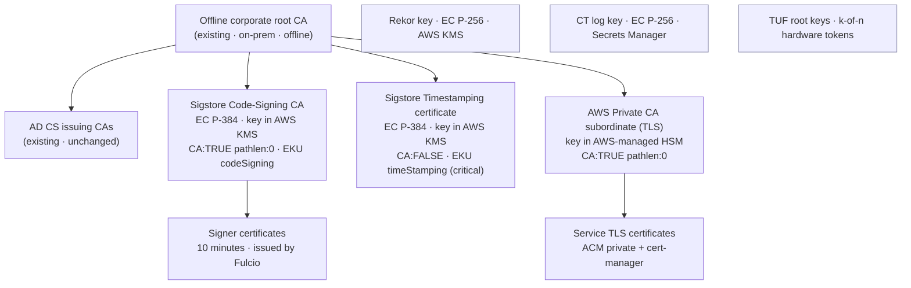
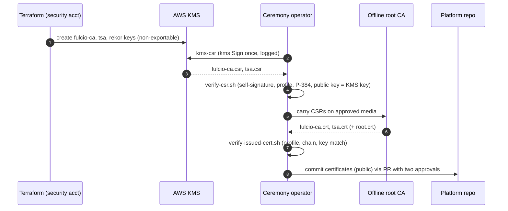

# 02 PKI and Key Ceremony

## 1. Hierarchy



### Why the Sigstore CA sits directly under the root

AD CS issuing CAs are normally issued with path length 0, so they cannot issue another CA. Placing the Sigstore CA directly under the offline root also keeps code-signing trust out of the Windows/TLS hierarchy: a compromise of an AD CS issuing CA cannot mint signing certificates that verifiers accept, because verifiers take intermediates only from `trusted_root.json` ([ADR-0004](../../docs/adr/0004-sigstore-ca-under-offline-root.md)).

> **Caveat: legacy signatures.** This holds for the bundle format (cosign v3 default) and for Kyverno, which loads intermediates from TUF. On cosign's *legacy* `.sig` path, if the verifier is not given intermediates, cosign builds them from the chain attached to the signature (`pkg/cosign/verify.go`), so a chain through a compromised AD CS issuing CA could reach the corporate root. Anyone verifying legacy signatures with the cosign CLI must pass `--trusted-root` (or `--certificate-chain` with the Sigstore CA). The optional OpenShift native policy uses the `.sig` format; see [05-consumer-clusters.md](05-consumer-clusters.md).

Verifiers do **not** need the corporate root in their OS trust store for signature verification. They need `trusted_root.json`, which carries the Sigstore CA and the root. The root in the OS store matters only for TLS to the Sigstore endpoints.

## 2. Certificate and key profiles

| Item | Algorithm | Validity | Extensions | Key custody |
|---|---|---|---|---|
| Sigstore Code-Signing CA | ECC NIST P-384, `ECDSA_SHA_384` | 5 years | `basicConstraints` critical CA:TRUE, pathlen:0 · `keyUsage` critical keyCertSign, cRLSign · `extendedKeyUsage` codeSigning · SKI · AKI | KMS `ECC_NIST_P384` / `SIGN_VERIFY`, multi-Region replica in DR |
| Sigstore Timestamping | ECC NIST P-384 | 5 years | `basicConstraints` critical CA:FALSE · `keyUsage` critical digitalSignature · `extendedKeyUsage` **critical** timeStamping (RFC 3161 §2.3) · SKI · AKI | KMS `ECC_NIST_P384` |
| AWS Private CA subordinate | ECC P-384 (`EC_secp384r1`; Private CA also offers EC P-256/P-521 and RSA 2048/3072/4096) | 5 years | CA:TRUE pathlen:0; recommended name constraint `permitted;DNS:.sigstore.corp.example` | AWS Private CA (AWS-managed HSM) |
| Rekor signing key | ECC NIST P-256 | Until rotated | — (public key goes in `trusted_root.json`) | KMS |
| CT log key | ECC P-256 | Until rotated | — | Secrets Manager (encrypted with KMS); legacy encrypted PEM, because the Sigstore `ctlog` chart's config generator reads and writes only that format and `ct_server` cannot use AWS KMS (PKCS#11, e.g. CloudHSM, is the HSM alternative) |
| Signer certificates | ECDSA P-256 (cosign default) | 10 minutes | Issued by Fulcio; SAN = identity; OIDC issuer extension | Ephemeral, never stored |

Fulcio refuses to start if the issuing CA in a chain lacks the codeSigning EKU (`pkg/ca/common.go`, `VerifyCertChain`). The chain Fulcio loads lists the Sigstore CA first and the root last. Go's `x509.Verify` applies that EKU to **every** certificate in the chain, so if the corporate root carries an EKU extension it must include codeSigning and timeStamping (or anyExtendedKeyUsage); a root with no EKU extension is unrestricted. `verify-issued-cert.sh` checks this.

Revocation: Sigstore verifiers do not consult CRLs or OCSP for Fulcio certificates. Compromise of the Sigstore CA is handled by giving its entry in `trusted_root.json` an end time and publishing that through TUF ([08-operations-dr.md](08-operations-dr.md) §6). Include CDP/AIA extensions only if your PKI policy requires them on every issued certificate.

## 3. Ceremony overview



Roles: **ceremony lead** (PKI), **key custodian(s)** for the offline root, **AWS operator** (assumes `sigstore-ceremony` role in the security account), **witness / recorder** (security or audit). Record each step with timestamps and hashes in the ceremony log template (`enterprise/pki-ceremony/ceremony-log.md`).

## 4. Ceremony procedure

### 4.1 Create the keys (Terraform)

`enterprise/terraform/modules/kms-signing-keys` creates:

| Alias | Spec | Who may `kms:Sign` |
|---|---|---|
| `alias/sigstore/fulcio-ca` | `ECC_NIST_P384` | Fulcio IRSA roles (prod and DR); the ceremony role **only inside the ceremony window** |
| `alias/sigstore/tsa` | `ECC_NIST_P384` | TSA IRSA roles; the ceremony role only inside the window |
| `alias/sigstore/rekor` | `ECC_NIST_P256` | Rekor IRSA role |
| `alias/sigstore/tuf-online` | `ECC_NIST_P256` | TUF publisher role (timestamp and snapshot metadata only) |

All keys: `deletion_window_in_days = 30`, `multi_region = true` with a replica in the DR Region. Key policy:

- `kms:ScheduleKeyDeletion` is denied to **all** principals. To delete a key, an administrator must first replace the policy, which raises the `PutKeyPolicy` alarm.
- `PutKeyPolicy`, enable/disable, aliases and replication are allowed only to `key_admin_role_arns`, which is the Terraform pipeline role (required by KMS's policy lockout check) plus the break-glass role. Neither can sign.
- The ceremony role has **no standing `kms:Sign`**. The ceremony PR sets `ceremony_window = { start, end }` (RFC 3339), which adds a `Sign` grant limited by `aws:CurrentTime`; a follow-up PR sets it back to `null` right after the ceremony. CloudTrail alarms on any `Sign` by that role.
- MFA is enforced by IAM Identity Center for the ceremony permission set. `aws:MultiFactorAuthPresent` is absent on SSO sessions, so it is not used as a condition.

### 4.2 Generate the certificate requests

```bash
cd enterprise/pki-ceremony/kms-csr
# The ceremony workstation is offline: build beforehand on a connected machine
# (`go mod vendor && go build -mod=vendor -o kms-csr .`) or use the binary
# attached to the signed release, and record its SHA-256 in the ceremony log.
sha256sum kms-csr
aws sts get-caller-identity                               # must be the sigstore-ceremony role
./kms-csr --key awskms:///arn:aws:kms:me-central-1:111111111111:alias/sigstore/fulcio-ca \
  --profile fulcio-ca --subject "CN=Example Bank Sigstore Code-Signing CA,O=Example Bank,C=AE" \
  --out fulcio-ca.csr
./kms-csr --key awskms:///arn:aws:kms:me-central-1:111111111111:alias/sigstore/tsa \
  --profile tsa --subject "CN=Example Bank Sigstore Timestamping,O=Example Bank,C=AE" \
  --out tsa.csr
../verify-csr.sh fulcio-ca.csr fulcio-ca awskms:///arn:aws:kms:me-central-1:111111111111:alias/sigstore/fulcio-ca
../verify-csr.sh tsa.csr tsa awskms:///arn:aws:kms:me-central-1:111111111111:alias/sigstore/tsa
```

`kms-csr` builds the request in Go's `crypto/x509` with a KMS-backed `crypto.Signer` (Sigstore's own `pkg/signature/kms` library), so the private key never leaves KMS. The request carries the extensions in §2 as requested extensions. The tool can also take `--key-file` with a PEM key, which is how CI tests it without AWS.

### 4.3 Sign at the offline root

The CSRs and `root.crt` are public data. Carry them on the approved media.

**If the offline root is a Windows standalone root CA (AD CS):**

A standalone CA does not use certificate templates and, by default, puts every request in **pending**. Submit, approve, then retrieve:

```bat
certreq -submit -config "ROOTHOST\Example Bank Root CA" fulcio-ca.csr
rem  -> note the RequestId, e.g. 12
certutil -config "ROOTHOST\Example Bank Root CA" -resubmit 12
certreq -retrieve -config "ROOTHOST\Example Bank Root CA" 12 fulcio-ca.crt
rem  repeat for tsa.csr
```

(`-attrib "CertificateTemplate:SubCA"` applies only to an *enterprise* CA; an offline root is normally standalone.) Whether the CA copies the **requested** EKU and path length depends on its policy module configuration (`CAPolicy.inf` and the policy module's `EditFlags`; for example `EDITF_ATTRIBUTEENDDATE` only lets the request set the validity period). Do not assume: step 4.4 checks the issued certificate and fails on any deviation.

**If the root is OpenSSL, EJBCA or another CA:** use the profiles in `enterprise/pki-ceremony/openssl-profiles.cnf` (`[ sigstore_ca ]`, `[ sigstore_tsa ]`):

```bash
openssl x509 -req -in fulcio-ca.csr -CA root.crt -CAkey <root key on HSM/engine> \
  -sha384 -days 1826 -extfile openssl-profiles.cnf -extensions sigstore_ca -out fulcio-ca.crt
```

### 4.4 Verify what was issued

```bash
../verify-issued-cert.sh fulcio-ca fulcio-ca.crt root.crt \
  awskms:///arn:aws:kms:me-central-1:111111111111:alias/sigstore/fulcio-ca
../verify-issued-cert.sh tsa tsa.crt root.crt \
  awskms:///arn:aws:kms:me-central-1:111111111111:alias/sigstore/tsa
```

Checks: chain to `root.crt`, validity, ECDSA P-384 key, that the root's EKU (if any) allows the purpose, CA flag and path length, key usage, EKU (codeSigning for the CA, critical timeStamping only for TSA), key identifiers, and that the certificate's public key equals the KMS public key (`aws kms get-public-key`). Requires OpenSSL 3 and GNU coreutils (`sha256sum`, `base64 -d`) on the ceremony workstation; on macOS install them with Homebrew rather than using the bundled LibreSSL. Any failure: stop and re-issue.

### 4.5 Publish the public material

```
enterprise/pki/
├── root.crt                   corporate root (public)
├── fulcio-ca.crt              Sigstore Code-Signing CA
├── fulcio-chain.pem           fulcio-ca.crt + root.crt   (→ Fulcio kms_cert_chain)
├── tsa.crt
├── tsa-chain.pem              tsa.crt + root.crt         (→ TSA cert_chain)
└── CEREMONY-<date>.md         signed ceremony record
```

Commit through a pull request that needs approvals from the PKI and platform CODEOWNERS. These files are public; no secret material is ever in Git.

## 5. TLS for the platform

1. Terraform creates an AWS Private CA **subordinate** CA in the security account and outputs its CSR.
2. The offline root signs it at the same ceremony (profile `[ tls_subordinate ]`, with the DNS name constraint).
3. The operator imports the signed certificate (`aws acm-pca import-certificate-authority-certificate`), which activates the CA; Terraform shares it with the Sigstore account through AWS RAM (`enterprise/terraform/modules/private-ca`). Private CA is Regional, so a second subordinate is created in the DR Region and signed at the same ceremony. CRL publication is off: the CA issues only short-lived TLS server certificates and nothing serves a CRL name inside the network (enable `enable_crl` only together with an internal CRL endpoint). AWS Private CA accepts a critical name constraints extension on an imported CA certificate.
4. The internal ALB uses an **ACM private certificate** for `*.sigstore.corp.example` issued by this CA. Renewal is managed by ACM in the **recipient** (Sigstore) account through ACM's service-linked role; if that role lacks permission, renewal silently stops, so the expiry alarm in [08-operations-dr.md](08-operations-dr.md) §2 covers it.
5. cert-manager's AWS Private CA issuer (`AWSPCAClusterIssuer`) issues pod certificates whose SANs are under `sigstore.corp.example` (e.g. Keycloak, the TUF server). The name constraint forbids `*.svc` / `*.cluster.local` SANs from this CA, so pod-to-pod calls on cluster-internal names (Fulcio → CT log, Rekor/CT log → Trillian gRPC) are restricted by namespace-based NetworkPolicy, as the upstream charts ship them without TLS (the ALB rules are not a pod-level boundary; see the header of `enterprise/helm/manifests/platform/network-policies.yaml`). If your standard requires TLS on those hops, add a service mesh with its own cluster-local CA, or a cert-manager `CA` issuer distributed with trust-manager; never widen the name constraint.
6. Fulcio receives the corporate root as `CACert` so it can fetch Keycloak's JWKS over TLS.

## 6. Keys that are not certificates

- **Rekor:** the KMS public key is exported once with `aws kms get-public-key` into `enterprise/pki/rekor.pub` and goes into `trusted_root.json`. Rekor's log ID is the SHA-256 of this public key.
- **CT log:** generated at the ceremony on the ceremony workstation as an encrypted PEM (`openssl ec -aes256`, legacy `Proc-Type: 4,ENCRYPTED` format that the Sigstore `ctlog` chart's config generator requires), stored in Secrets Manager with a KMS key the CT log role alone can decrypt, then wiped from the workstation. `ctlog.pub` is committed.
- **TUF root keys:** see [04-trust-distribution.md](04-trust-distribution.md).

## 7. Rotation schedule

| Item | Rotate | How |
|---|---|---|
| Sigstore Code-Signing CA | Every 4 years (5-year validity), or on compromise | New KMS key + ceremony; publish trusted root with old CA `end-time` = switch time; keep old CA in the trusted root until no signed artifact needs it |
| TSA certificate | Every 4 years | Same |
| Rekor key | Only on compromise or algorithm change | New key; trusted root lists old key with end-time and new with start-time |
| CT log key | Only on compromise | Same pattern |
| AWS Private CA subordinate | Before expiry | Ceremony; ACM and cert-manager pick up new issuance |
| TUF online keys | Yearly | TUF root update signed by k-of-n offline keys |
| TUF root keys | Every 2–3 years, or on custodian change | TUF root rotation ceremony |
