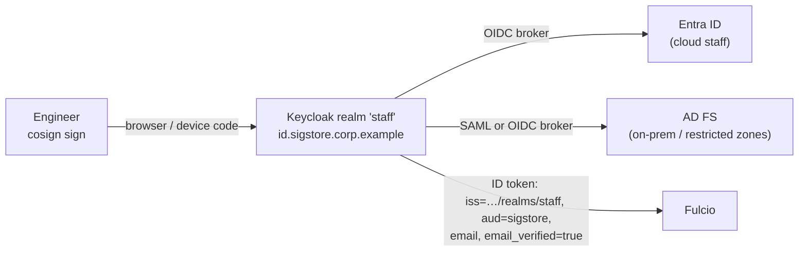

# 03 Identity

Fulcio issues a certificate only for an OIDC token from an issuer it is configured to trust. This design trusts exactly two issuers in production:

| Issuer | Who | Certificate identity (SAN) | Fulcio type |
|---|---|---|---|
| `https://token.actions.githubusercontent.com/example-bank` | GitHub Actions workflows in your enterprise | URI: `https://github.com/<org>/<repo>/.github/workflows/<file>@<ref>` | `ci-provider` (GitHub templates) |
| `https://id.sigstore.corp.example/realms/staff` | People, through Keycloak brokering Entra ID and AD FS | E-mail: `firstname.lastname@example-bank.com` | `email` |

## 1. GitHub Enterprise Cloud

### 1.1 Use the enterprise-unique issuer

By default every GitHub Actions token on github.com has `iss = https://token.actions.githubusercontent.com`, shared by all GitHub customers. If Fulcio trusted that issuer, any GitHub user could obtain a certificate from your CA for their own workflow. Policies would still reject those certificates, but your CA and your CT log would be signing for strangers.

GitHub Enterprise Cloud lets an enterprise administrator switch to a unique issuer, `https://token.actions.githubusercontent.com/<enterpriseSlug>`, through the REST endpoint `PUT /enterprises/{enterprise}/actions/oidc/customization/issuer` with `{"include_enterprise_slug": true}` ([GitHub docs: OIDC reference](https://docs.github.com/en/enterprise-cloud@latest/actions/reference/security/oidc)).

```bash
# Run by a GitHub enterprise administrator (token with admin:enterprise scope)
gh api -X PUT /enterprises/example-bank/actions/oidc/customization/issuer \
  -F include_enterprise_slug=true
gh api /enterprises/example-bank/actions/oidc/customization/issuer
```

**Side effect to plan for:** the `iss` claim changes for **every** workflow in the enterprise at once. Anything that already trusts GitHub OIDC (for example AWS IAM OIDC identity providers for `token.actions.githubusercontent.com`, Azure federated credentials, Vault JWT roles) must also trust the new issuer URL **before** the switch. Add the new provider alongside the old one, flip the setting, then remove the old one. If you use GHE.com with data residency, the host becomes `token.actions.<subdomain>.ghe.com`; substitute it everywhere below.

### 1.2 Fulcio configuration

Fulcio v1.9.0 supports GitHub through `ci-provider` with claim-mapping templates (`pkg/config/config.go`, `CIIssuerMetadata`). The production values file (`enterprise/helm/values/prod/fulcio.yaml`) sets, in Fulcio's YAML config format:

```yaml
oidc-issuers:
  https://token.actions.githubusercontent.com/example-bank:
    issuer-url: https://token.actions.githubusercontent.com/example-bank
    client-id: sigstore
    type: ci-provider
    ci-provider: github-workflow
ci-issuer-metadata:
  github-workflow:
    default-template-values:
      url: https://github.com
    extension-templates:            # same mapping as public Fulcio
      github-workflow-trigger: event_name
      github-workflow-sha: sha
      github-workflow-repository: repository
      github-workflow-ref: ref
      build-signer-uri: "{{ .url }}/{{ .job_workflow_ref }}"
      build-signer-digest: job_workflow_sha
      runner-environment: runner_environment
      source-repository-uri: "{{ .url }}/{{ .repository }}"
      source-repository-digest: sha
      source-repository-ref: ref
      source-repository-identifier: repository_id
      source-repository-owner-uri: "{{ .url }}/{{ .repository_owner }}"
      source-repository-owner-identifier: repository_owner_id
      build-config-uri: "{{ .url }}/{{ .workflow_ref }}"
      build-config-digest: workflow_sha
      build-trigger: event_name
      run-invocation-uri: "{{ .url }}/{{ .repository }}/actions/runs/{{ .run_id }}/attempts/{{ .run_attempt }}"
      source-repository-visibility-at-signing: repository_visibility
    subject-alternative-name-template: "{{ .url }}/{{ .job_workflow_ref }}"
```

The SAN is built from `job_workflow_ref`, so a reusable workflow signs as **the reusable workflow**, not as the calling repository. That lets you centralise signing in one reviewed workflow (`example-bank/platform-workflows/.github/workflows/sign.yml@refs/heads/main`) and still see the calling repository in the `source-repository-*` extensions.

Workflows need `id-token: write`. cosign detects it is running in GitHub Actions and requests the token itself with audience `sigstore`; no token handling appears in the workflow:

```yaml
permissions:
  id-token: write      # lets cosign request the OIDC token
  contents: read
```

### 1.3 Egress

Fulcio fetches GitHub's JWKS from `https://token.actions.githubusercontent.com/example-bank/.well-known/openid-configuration` and the `jwks_uri` it points to. Allow exactly that host through the central egress inspection.

## 2. People: Keycloak as the broker



Why a broker rather than trusting Entra ID directly ([ADR-0005](../../docs/adr/0005-keycloak-as-oidc-broker.md)):

- Fulcio's `email` issuer type requires `email_verified: true`. Entra ID access/ID tokens do not reliably carry that claim; Keycloak sets it for users brokered from identity providers you trust.
- AD FS-only zones work the same way as Entra-backed ones.
- One issuer for verifiers. Changing or adding an upstream IdP never changes a policy.

### 2.1 Realm design (`staff`)

| Setting | Value |
|---|---|
| Client `sigstore` | Public, PKCE S256, standard flow + device authorization grant; **direct access grants off** |
| Redirect URIs | `http://localhost:8765/auth/callback` exactly (cosign `--oidc-redirect-url`) |
| Audience mapper | `aud` includes `sigstore` |
| Identity provider `entra` | OIDC (v2.0 endpoint `https://login.microsoftonline.com/<tenant-id>/v2.0`), client secret in Secrets Manager. App registration: **assignment required** (employee group only, no guests), optional claim `upn`. Keycloak maps e-mail from `upn` (tenant-verified domains), never from Entra's unverified `email` claim, then **Trust email** marks it verified; *Disable user info* on |
| Identity provider `adfs` | OIDC (`https://adfs.corp.example/adfs`), application group `sigstore-keycloak`; e-mail mapped from `upn`, which must equal the user's mailbox address |
| Mappers | `email` ← `upn` for both IdPs; `emailVerified` true only for these two trusted IdPs (`trustEmail`) |
| Local users | None, except one break-glass admin in the `master` realm |
| Token lifetimes | Access/ID token 5 min; SSO session idle 30 min; device code 10 min |
| MFA | Enforced upstream (Entra Conditional Access, AD FS); Keycloak trusts the upstream `amr`/`acr` |

### 2.2 Who should sign as a person?

Production images should be signed by pipelines. Human signatures are for: break-glass releases, signing third-party artifacts after review, and attestations such as approvals. Kyverno policies for production namespaces do not accept e-mail identities unless a namespace explicitly opts in.

## 3. Identities in policy

Write policies against the most specific stable identity:

| Need | How to express it in Kyverno 1.19 | Example |
|---|---|---|
| "Signed by our central signing workflow" | `identities[].subject` (exact SAN) | `https://github.com/example-bank/platform-workflows/.github/workflows/sign.yml@refs/heads/main` |
| "Built from one repository" | `additionalExtensions.githubWorkflowRepository` | `example-bank/payments-api` |
| "Only from main" | `additionalExtensions.githubWorkflowRef` | `refs/heads/main` |
| "Any repo in our org, protected branch" | `identities[].subjectRegExp` | `^https://github\.com/example-bank/[^/]+/\.github/workflows/[^@]+@refs/heads/main$` |
| "A named engineer approved" | `identities[].subject` + staff issuer | `jane.doe@example-bank.com` |

Kyverno's `additionalExtensions` enforces only the five GitHub workflow extensions (`githubWorkflowTrigger`, `githubWorkflowSha`, `githubWorkflowName`, `githubWorkflowRepository`, `githubWorkflowRef`); any other key is rejected or ignored (`pkg/image/verifiers/ivpol/cosign/opts.go`, `applyAdditionalExtensions`, Kyverno v1.19.2). Conditions on `runner-environment` or `source-repository-owner-uri` therefore need a reusable signing workflow that only runs on your runners, or a verification step in CI with `cosign verify --certificate-github-workflow-*`/policy tooling. The issuer is always matched through `identities[].issuer`. See [05-consumer-clusters.md](05-consumer-clusters.md) §3 for the policy files.
