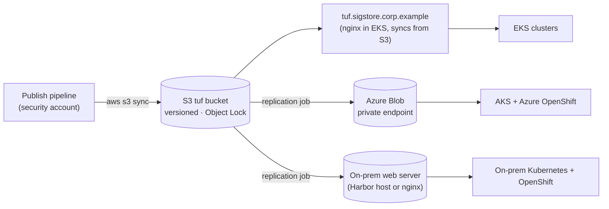

# 04 Trust Distribution (TUF)

Verifiers need one file, `trusted_root.json`, listing the Fulcio CA chain, the Rekor and CT log public keys, and the TSA chain, each with a validity window. TUF (The Update Framework) is how that file reaches every cluster, laptop and runner securely, and how it changes when you rotate a key, without anyone touching the clients.

## 1. What clients pin

Each client pins **one file, once**: the TUF `root.json`. After that it downloads signed metadata from any mirror and accepts a new `trusted_root.json` only if it is signed by keys the pinned root authorises. A mirror can be an S3 bucket, an Azure Blob container or an on-prem web server; mirrors are untrusted storage because the metadata is signed.

| Client | How it pins the root |
|---|---|
| Kyverno (every cluster) | `attestors[].cosign.tuf.root.data` (base64 of `root.json`) and `tuf.mirror` = nearest replica |
| cosign on runners and laptops | `cosign initialize --mirror <replica> --root /etc/sigstore/tuf-root.json` (baked into runner images, pushed by MDM) |
| gitsign on runners and laptops | same `cosign initialize`, then `export-trust.sh` turns the downloaded `trusted_root.json` into the files gitsign reads ([11-gitsign.md](11-gitsign.md) §1) |
| Anything using sigstore-go | `tuf.Options{Root: ..., RepositoryBaseURL: ...}` |

## 2. Roles and keys

| TUF role | Signs | Keys | Threshold | Metadata expiry | When it is signed |
|---|---|---|---|---|---|
| root | which keys hold every role | 3 hardware tokens (YubiKey PIV / HSM) held by named custodians | 2 of 3 | 365 days | Yearly, and when a custodian or key changes |
| targets | `trusted_root.json`, `signing_config.v0.2.json` | Same offline tokens | 2 of 3 | 180 days | When trust material changes (key rotation) and at least every 5 months |
| snapshot | versions of targets metadata | AWS KMS key `alias/sigstore/tuf-online` | 1 | 7 days | Automatically, every 6 hours |
| timestamp | freshness of snapshot | Same KMS key | 1 | 7 days | Automatically, every 6 hours |

Why these numbers: an attacker who steals the online KMS-signing permission can only replay or freeze existing trust material for at most 7 days; they cannot add a CA or a log key, because that needs 2 of 3 offline tokens. The 7-day timestamp (rather than 1 day) gives the publishing job a long margin before clients start failing closed; the job runs every 6 hours and alerts when less than 3 days remain.

## 3. Repository layout and tooling

`enterprise/tuf/tufctl.py` (python-tuf `Metadata` API with securesystemslib signers) manages the repository:

```bash
# once: three custodian public keys (exported from their tokens) and the online KMS public key
aws kms get-public-key --key-id alias/sigstore/tuf-online --query PublicKey --output text \
  | base64 -d | openssl pkey -pubin -inform DER -out online.pub
tufctl.py init        --repo repo --root-key c1.pub --root-key c2.pub --root-key c3.pub --online-pub online.pub
tufctl.py add-target  --repo repo trusted_root.json signing_config.v0.2.json            # on any trust change
tufctl.py sign        --repo repo --role targets --signer hsm: --pub c1.pub              # each custodian
tufctl.py sign        --repo repo --role root    --signer hsm: --pub c1.pub              # each custodian
tufctl.py root-update --repo repo [--add-root-key c4.pub] [--remove-root-key c3.pub]     # yearly / key rotation
tufctl.py refresh     --repo repo --online-signer "awskms:$ARN" --online-pub online.pub  # every 6 h (pipeline)
tufctl.py verify      --repo repo --root enterprise/tuf/root/1.root.json                 # as a client would
```

The published tree is static files: `root.json` (and versioned `N.root.json`), `timestamp.json`, `N.snapshot.json`, `N.targets.json`, `targets/<sha256>.<name>`.

## 4. Publication and replicas



- The S3 bucket is the source of truth: versioning on, S3 Object Lock in governance mode (30 days) so a compromised pipeline cannot erase history, bucket policy allows writes only from the publish role.
- Replicas are read-only for consumers. Upload order matters: `targets/` and versioned metadata first, then `snapshot`, then `timestamp.json` last, so a client never sees a timestamp that points at metadata not yet uploaded.
- Each replica has its own DNS name and TLS certificate in its own network: `tuf.sigstore.corp.example` (AWS), `tuf-az.sigstore.corp.example` (Azure Private DNS → internal Application Gateway → storage static website over a private endpoint; see 05 §4.2), `tuf-onprem.sigstore.corp.example`.

## 5. Rotation through TUF (example: new Fulcio CA)

1. Ceremony issues the new CA ([02-pki-and-ceremony.md](02-pki-and-ceremony.md) §7).
2. Build the new trusted root with **both** CAs; the old one gets `end-time` = switch time:
   ```bash
   cosign trusted-root create \
     --fulcio "url=https://fulcio.sigstore.corp.example,certificate-chain=fulcio-chain-2026.pem,end-time=2030-06-01T00:00:00Z" \
     --fulcio "url=https://fulcio.sigstore.corp.example,certificate-chain=fulcio-chain-2030.pem,start-time=2030-06-01T00:00:00Z" \
     --rekor "url=https://rekor.sigstore.corp.example,public-key=rekor.pub,start-time=<original>" \
     --ctfe  "url=https://ctlog.sigstore.corp.example,public-key=ctlog.pub,start-time=<original>" \
     --tsa   "url=https://tsa.sigstore.corp.example/api/v1/timestamp,certificate-chain=tsa-chain.pem" \
     --out trusted_root.json
   ```
3. `tufctl.py add-target`, two custodians sign `targets`, pipeline refreshes snapshot/timestamp and publishes.
4. Clients pick it up on their next refresh. Then switch Fulcio to the new key.

Signatures made before the switch keep verifying because their Rekor timestamps fall inside the old CA's validity window.

## 6. Failure modes

| Failure | Effect | Mitigation |
|---|---|---|
| Publish pipeline down | Timestamp expires after 7 days; Kyverno then cannot refresh trust and denies new Pods | Alert at 3 days remaining; runbook to run `refresh` manually with the break-glass role |
| A replica unreachable | That region's clusters use cached metadata until expiry | Each cluster points at its nearest replica; Kyverno caches; monitor replica freshness |
| Offline key custodian unavailable | Cannot change targets | 2-of-3 threshold; documented custodian succession |
| Online KMS key compromised | Attacker can re-sign snapshot/timestamp only | Cannot add trust; new KMS key, then `tufctl.py root-update --online-pub new.pub` signed 2-of-3 by old and new custodian sets |
