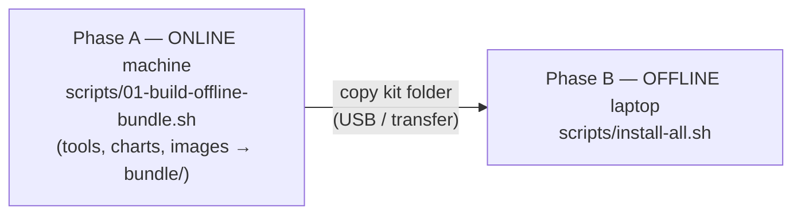

# 00 — Getting Started

A private Sigstore (Keycloak + Fulcio + CT log + Rekor + Trillian + TUF +
registry + Kyverno) running in kind on your laptop, with **no internet access**.

## 1. Two phases



## 2. Prerequisites (short version)

* Linux, or Windows 10/11 with **WSL2 (Ubuntu)** + Docker Desktop (WSL integration on).
* Docker with **8 GB RAM / 4 CPUs**; ports 80, 443, 5000, 6443 free on 127.0.0.1.
* Full list and Windows tips: [02 §0](02-installation-guide.md#0-prerequisites).

## 3. Quick start

```bash
# ---------- Phase A (online) ----------
cd sigstore-offline
chmod +x scripts/*.sh
DOCKERHUB_MIRROR=mirror.gcr.io WITH_WINDOWS_CLI=1 scripts/01-build-offline-bundle.sh
# copy the whole sigstore-offline/ folder (with bundle/) to the offline laptop

# ---------- Phase B (offline laptop, WSL/Linux shell) ----------
cd ~/sigstore-offline
scripts/03-generate-pki.sh                      # keys first (hosts helper needs the CA)
sudo scripts/setup-hosts.sh --trust-ca          # Linux/WSL: hosts + trust TLS root
#   Windows: Administrator PowerShell -> .\windows\Setup-Hosts.ps1 ; then `wsl --shutdown`
scripts/install-all.sh                          # ~10-15 min
```

`install-all.sh` ends with `verify-stack.sh` — every line should say **PASS**.

## 4. Your first keyless signature (2 minutes)

```bash
export PATH="$PWD/bundle/bin:$PATH"
source out/cosign.env

scripts/10-sign-and-verify.sh          # opens the Keycloak login (user: alice)
#   password: grep DEMO_USER_PASSWORD pki/secrets.env
scripts/11-inspect-rekor.sh            # see the entry in YOUR transparency log
```

Or by hand:

```bash
IMAGE=registry.sigstore.local/demo/hello@$(crane digest registry.sigstore.local/demo/hello:v1)
cosign sign --yes --signing-config "$SIGSTORE_SIGNING_CONFIG" --trusted-root "$SIGSTORE_TRUSTED_ROOT" \
  --oidc-redirect-url "$SIGSTORE_OIDC_REDIRECT_URL" "$IMAGE"
cosign verify --trusted-root "$SIGSTORE_TRUSTED_ROOT" \
  --certificate-identity alice@sigstore.local \
  --certificate-oidc-issuer https://keycloak.sigstore.local/realms/sigstore "$IMAGE"
```

Sign your git commits the same way (keyless, same login): `scripts/14-configure-gitsign.sh --global`, then [13-gitsign.md](13-gitsign.md).

## 5. See enforcement

```bash
kubectl --context kind-sigstore -n demo run ok  --image="$IMAGE"                                  # admitted
kubectl --context kind-sigstore -n demo run bad --image=registry.sigstore.local/demo/unsigned:v1  # denied
```

## 6. Where things are

| You want… | Go to |
|---|---|
| How it fits together, diagrams, trust model | [01 Architecture Overview](01-architecture-overview.md) |
| Every step, command, config file, verification | [02 Installation Guide](02-installation-guide.md) |
| Sign / verify / attest / inspect Rekor by hand | [03 Keyless Signing Workflow](03-keyless-signing-workflow.md) |
| Production, corporate IdP, trust distribution, CI | [04 Enterprise Rollout](04-enterprise-rollout.md) |
| Day-2: logs, upgrades, rotation | [05 Operations & Maintenance](05-operations-maintenance.md) |
| Backups, restore, incident playbooks | [06 Disaster Recovery](06-disaster-recovery.md) |
| What to tighten for real use | [07 Security Hardening](07-security-hardening.md) |
| Something broke | [08 Troubleshooting](08-troubleshooting.md) |
| Quick answers | [09 FAQ](09-faq.md) |
| Every file and value explained | [10 Configuration Reference](10-configuration-reference.md) |
| What was tested, how, and what wasn't | [11 Test Report](11-test-report.md) |
| What every tool is and why it's used | [12 Tools Reference](12-tools-reference.md) · Word / PowerPoint versions in docs/ |
| Prefer a UI for config, install and health checks | [14 Control Panel dashboard](14-dashboard.md) — `scripts/dashboard.sh` (local, offline) |

## 7. Endpoints and credentials

| What | Value |
|---|---|
| OIDC issuer | `https://keycloak.sigstore.local/realms/sigstore` |
| Fulcio | `https://fulcio.sigstore.local` |
| Rekor | `https://rekor.sigstore.local` |
| Registry | `https://registry.sigstore.local` |
| TUF mirror | `https://tuf.sigstore.local` (bootstrap root `out/tuf/root.json`) |
| Demo human | `alice` / `alice@sigstore.local` / `DEMO_USER_PASSWORD` |
| Demo CI identity | client `sigstore-ci` / `ci@sigstore.local` / `CI_CLIENT_SECRET` |
| Keycloak admin | `https://keycloak.sigstore.local/admin` — `admin` / `KEYCLOAK_ADMIN_PASSWORD` |

All passwords are random and live in `pki/secrets.env`.
