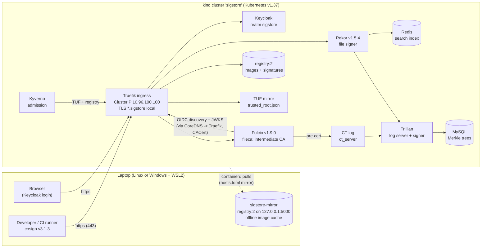
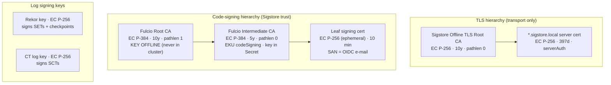
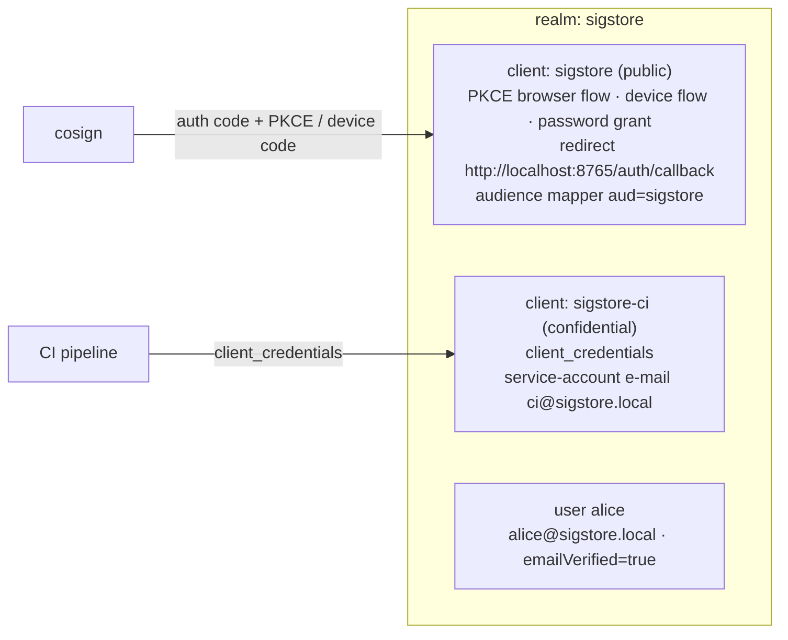
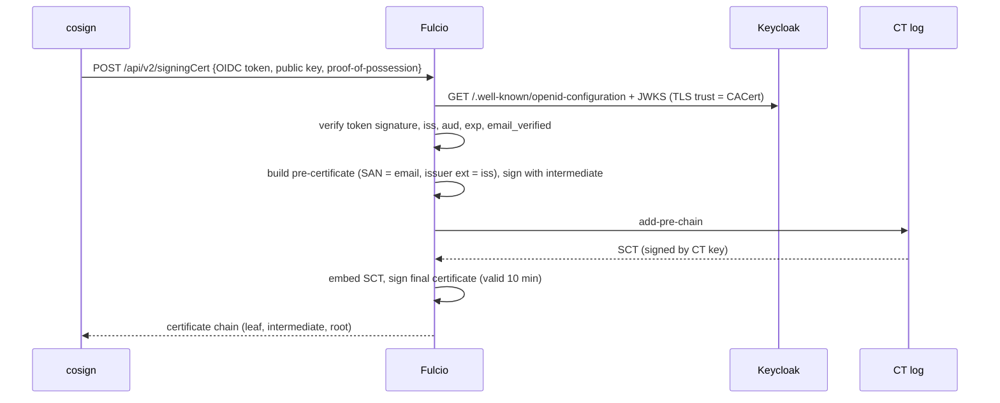
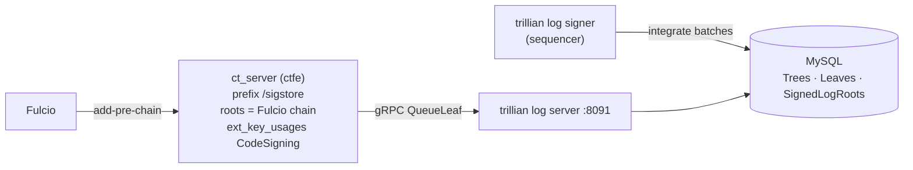
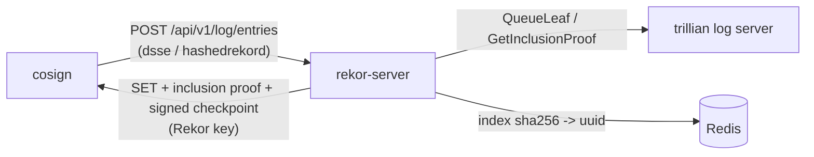
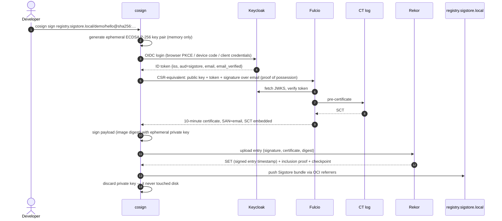

# 01 — Architecture Overview

> **Audience:** platform, security and DevOps engineers who need to understand *what*
> runs, *why* it is shaped this way, and *where trust comes from* before deploying it.

---

## 1. What this stack is

A complete, **private and offline** Sigstore deployment:

| Concern | Public Sigstore | This kit |
|---|---|---|
| Identity (OIDC) | Google / GitHub / Microsoft via `oauth2.sigstore.dev` | **Keycloak** realm `sigstore` (`https://keycloak.sigstore.local/realms/sigstore`) |
| Code-signing CA | Fulcio at `fulcio.sigstore.dev`, roots in public TUF | **Fulcio** with **your** offline root + online intermediate |
| Certificate Transparency | Sigstore CT log | **CT log** (trillian ctfe) with **your** key |
| Transparency log | Rekor at `rekor.sigstore.dev` | **Rekor** with **your** signer key, on **your** Trillian/MySQL |
| Trust distribution | `tuf-repo-cdn.sigstore.dev` | **Private TUF mirror** (`https://tuf.sigstore.local`) + `trusted_root.json` |
| Artifact store | any registry | **registry:2** at `https://registry.sigstore.local` |
| Enforcement | — | **Kyverno** `ImageValidatingPolicy` |
| Network | internet | **none** — images come from a local mirror, every name is `*.sigstore.local` |

Nothing in the running system resolves or contacts a public hostname. The
integration test (`test/compose/run.sh`) proves this by running every client
step inside a Docker network created with `--internal` (no route out).

---

## 2. High-level picture



### Namespaces

| Namespace | Workloads | Exposed as |
|---|---|---|
| `traefik` | Traefik v3.7.14 | host ports 80/443 (127.0.0.1), ClusterIP `10.96.100.100` |
| `keycloak` | Keycloak 26.8.1 (H2 on PVC) | `https://keycloak.sigstore.local` |
| `trillian-system` | MySQL, log server, log signer, createdb Job | in-cluster only |
| `rekor-system` | rekor-server, Redis, createtree Job | `https://rekor.sigstore.local` |
| `fulcio-system` | fulcio-server | `https://fulcio.sigstore.local` |
| `ctlog-system` | ct_server, createtree + createctconfig Jobs | in-cluster only (`http://ctlog.ctlog-system.svc/sigstore`) |
| `registry` | registry:2.8.3 (PVC) | `https://registry.sigstore.local` |
| `tuf-system` | static TUF repository server | `https://tuf.sigstore.local` |
| `kyverno` | Kyverno 1.19.1 controllers | admission webhook |

---

## 3. Name resolution and TLS — how "offline" actually works

Everything is addressed by `*.sigstore.local`. Three different resolvers are
pointed at the same front door:

| Who resolves | How | Answer |
|---|---|---|
| Laptop (cosign, curl, browser, docker) | hosts file (`scripts/setup-hosts.sh`, `windows/Setup-Hosts.ps1`) | `127.0.0.1` → kind port-map → Traefik |
| Pods (Fulcio → Keycloak, Kyverno → registry/TUF) | CoreDNS extra zone `sigstore.local` (`config/coredns/…`) | `10.96.100.100` (Traefik Service) |
| Node containerd (pulling *your* images) | node `/etc/hosts` (`scripts/fix-node-dns.sh`) | `10.96.100.100` |

Because **every caller goes through the same Traefik and the same certificate**,
the OIDC issuer string (`https://keycloak.sigstore.local/realms/sigstore`) is
identical for cosign, Keycloak and Fulcio — a hard requirement, since Fulcio
compares the token's `iss` claim byte-for-byte with its configured `IssuerURL`.

Images for the platform itself never leave the laptop: containerd inside the
kind node has one `hosts.toml` per upstream registry
(`docker.io`, `ghcr.io`, `quay.io`, `gcr.io`, `registry.k8s.io`, `reg.kyverno.io`)
that redirects pulls to `http://sigstore-mirror:5000/v2/<registry>/<repo>` with
`override_path = true`. The mirror was populated by `crane copy`, which keeps the
original manifest **digests**, so the digest-pinned references in the Helm
charts resolve unchanged.

---

## 4. Two separate PKIs



**Why separate?** A leaked TLS key lets an attacker impersonate a *server*; a
leaked code-signing key lets them mint *signatures*. Keeping the hierarchies
apart means neither compromise implies the other, and each can be rotated on
its own schedule.

**Why an intermediate?** The root key stays encrypted on offline media
(`pki/fulcio/root.key`). Only the intermediate is loaded into Fulcio. If the
intermediate is compromised you issue a new one from the root and clients that
trust the root keep working (see docs/05 §6).

**Fulcio constraint (verified in source, `pkg/ca/common.go`):** when the chain
has an intermediate, the issuing certificate **must** carry
`extendedKeyUsage = codeSigning`, otherwise Fulcio refuses to start. The PKI
script enforces and checks this.

---

## 5. Component deep-dives

### 5.1 Keycloak (OIDC)



* `KC_HOSTNAME=https://keycloak.sigstore.local` pins the issuer regardless of
  which path a request took.
* Tokens live 5 minutes — Fulcio only needs them for one request.
* Fulcio `Type: email` requires `email_verified: true`; both identities have it.
* The audience mapper puts `sigstore` in `aud` (Fulcio checks `aud ⊇ ClientID`).

### 5.2 Fulcio



* Backend `fileca`: `--fileca-cert` = `chain.pem` (intermediate **first**, root
  last), `--fileca-key` = encrypted PKCS#8 intermediate key, password from Secret.
* `CACert` in the issuer config is how a distroless Fulcio trusts a privately
  issued Keycloak certificate (field present since Fulcio v1.7; checked in v1.9.0).
* Fulcio's SSRF guard blocks private IPs for **meta-issuers**, but explicitly
  allows them for issuers listed in `OIDCIssuers` — which is why Keycloak's
  cluster-internal address is fine.

### 5.3 CT log and Trillian



* `createtree` Job asks Trillian for a new LOG tree and stores its ID in
  ConfigMap `ctlog-config`.
* `createctconfig` Job fetches Fulcio's root over HTTP **in-cluster**, reads our
  key from Secret `ctlog-signer`, and writes the ctfe protobuf config into
  Secret `ctlog-secret`.
* The CT key must be **legacy-encrypted PEM** (`Proc-Type: 4,ENCRYPTED`): that is
  the only encrypted format `DecryptExistingPrivateKey` accepts.

### 5.4 Rekor



* Signer = **file** (`--rekor_server.signer=/var/run/rekor-signer/rekor.key`).
  The chart default `memory` would generate a new key on every restart and
  silently invalidate every client's trust root.
* Redis is only a search index; it can be rebuilt from the log.
* The Rekor **log ID** is `sha256(DER(public key))` — the same value
  `11-inspect-rekor.sh` prints as `logID`, and what `trusted_root.json` keys on.

### 5.5 Private registry

`registry:2.8.3` with a PVC, behind Traefik TLS. Cosign v3 stores signatures
and attestations as **Sigstore bundles attached as OCI 1.1 referrers** next to
the image. registry 2.8 has no `/referrers` endpoint, so cosign uses the spec's
tag-schema fallback (an index tagged `sha256-<digest>`); `cosign tree` and
Kyverno read it transparently. Kubernetes nodes pull user images from it through
containerd's `hosts.toml` (CA = TLS root).

### 5.6 TUF mirror

A static TUF repository (root → targets/snapshot/timestamp) whose targets are
the very files cosign uses: `trusted_root.json`, `signing_config.v0.2.json`,
plus legacy `fulcio_v1.crt.pem`, `fulcio_intermediate_v1.crt.pem`, `rekor.pub`,
`ctfe.pub`. Clients pin `root.json` once:

```bash
cosign initialize --mirror https://tuf.sigstore.local --root out/tuf/root.json
```

After that, `cosign sign` / `verify` need **no** trust flags at all (tested), and
Kyverno bootstraps from the same mirror. Rotation = republish the repository.

### 5.7 Kyverno

`ImageValidatingPolicy` (`policies.kyverno.io/v1`, stable in 1.19) matches Pods
using `registry.sigstore.local/*` and calls
`verifyImageSignatures(image, [attestors.privateSigstore])`. Trust comes from
the TUF mirror; with no `ctlog` block the Rekor inclusion proof and SCT are
verified **offline** from the bundle (no Rekor API call at admission time).

---

## 6. How keyless signing works internally



Verification is the mirror image, and needs only `trusted_root.json`:

1. Chain the leaf certificate to the Fulcio root in `trusted_root.json`.
2. Verify the embedded **SCT** with the CT log key → the cert was publicly logged.
3. Verify the **Rekor inclusion proof / SET** with the Rekor key, and that the
   entry's integrated time falls inside the certificate's 10-minute validity →
   the signature was made while the cert was valid, so the cert expiring later
   does not matter.
4. Check the signature over the image digest with the leaf's public key.
5. Check **policy**: SAN (`alice@sigstore.local`) and issuer extension
   (`https://keycloak.sigstore.local/realms/sigstore`) match what you require.

Steps 1–4 are cryptographic and fully offline; step 5 is your authorization
decision.

---

## 7. How private PKI replaces public Fulcio/Rekor

| Public Sigstore trust anchor | Replaced by | Distributed via |
|---|---|---|
| Fulcio root + intermediates in public TUF | `pki/fulcio/root.crt` + `intermediate.crt` | `trusted_root.json` → TUF mirror / file |
| Rekor public key in public TUF | `pki/rekor/rekor.pub` | same |
| CT log key in public TUF | `pki/ctlog/ctlog.pub` | same |
| `tuf-repo-cdn.sigstore.dev` root | `out/tuf/root.json` | MDM, golden images, ConfigMap, CI runner images |
| OIDC providers (Google/GitHub/MS) | Keycloak realm (or your corporate IdP) | Fulcio `config.json` |
| `oauth2.sigstore.dev`, `*.sigstore.dev` URLs | `*.sigstore.local` | `signing_config.json` |

`trusted_root.json` and `signing_config.json` are generated with cosign's own
`cosign trusted-root create` / `cosign signing-config create`, so their format
always matches what the cosign version in use expects.

---

## 8. Data that matters (and where it lives)

| Data | Location | Loss impact | Backup |
|---|---|---|---|
| Fulcio root key + password | `pki/fulcio/root.key`, `pki/secrets.env` | cannot issue new intermediates; must re-root (all clients) | encrypted, offline, 2 copies |
| Fulcio intermediate, Rekor key, CT key | `pki/…` + Secrets | rotate key, update trusted root | `scripts/backup.sh` |
| Transparency history | MySQL PVC (`trillian-system`) | old signatures lose their log proof **only** for re-verification against Rekor online; bundles stay verifiable offline | `mysqldump` in `backup.sh` |
| Tree IDs | ConfigMaps `rekor-config`, `ctlog-config` | log appears empty after redeploy | `tree-ids.env` in backup |
| Identities | Keycloak H2 PVC | users must be recreated | `backup.sh` |
| Images + signatures | registry PVC | re-push + re-sign | registry/volume snapshots |
| Redis | `rekor-redis` | search by hash slower until rebuilt | not needed |
