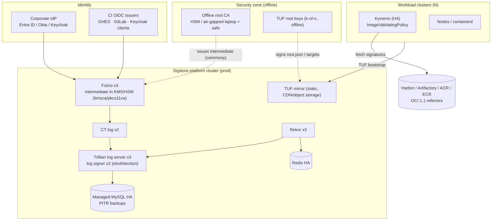

# 04 — Enterprise-wide Rollout Plan

How to go from the laptop lab to a production, organisation-wide private
Sigstore. The laptop kit is deliberately built from the same charts and the
same trust model, so the move is mostly about **availability, key custody,
identity integration and distribution**.

---

## 1. Target architecture



## 2. Production deployment (Kubernetes)

### 2.1 Phased plan

| Phase | Weeks | Deliverable | Exit criteria |
|---|---|---|---|
| 0. Design & ceremony | 1–2 | key custody design, root CA ceremony, TUF root ceremony, DNS/TLS names, IdP app registrations | signed ceremony record; root offline in two locations |
| 1. Platform build | 2–3 | prod cluster, Trillian/Rekor/Fulcio/CT/TUF via GitOps, monitoring, backups | `verify-stack`-equivalent probes green; restore drill passed |
| 2. Pilot | 2–4 | 2–3 pipelines signing; 1 workload cluster in **Audit** | 100% of pilot images signed; no false denials for 2 weeks |
| 3. Broad CI adoption | 4–8 | shared CI templates, runner images with trust baked in | ≥95% of deployable images signed |
| 4. Enforce | 2–4 per cluster | Kyverno **Deny** per namespace tier (dev → staging → prod) | exceptions process live; break-glass tested |
| 5. Operate | ongoing | rotation calendar, DR drills, metrics/SLOs | quarterly DR test, TUF refresh < expiry |

### 2.2 What changes from the laptop

| Area | Laptop kit | Production |
|---|---|---|
| Cluster | kind, 1 node | dedicated hardened cluster (3+ nodes, 3 AZs) |
| Ingress | Traefik + wildcard self-issued cert | your standard ingress / Gateway API + certs from the corporate CA (cert-manager) |
| Fulcio CA backend | `fileca` (encrypted key in Secret) | `kmsca` (AWS/GCP/Azure KMS, HashiCorp Vault) or `pkcs11ca` (HSM); chain in values `server.args.kms_cert_chain` |
| Rekor signer | file key in Secret | KMS URI (`--rekor_server.signer=awskms://…`, `gcpkms://…`, `azurekms://…`, `hashivault://…`) |
| CT log key | legacy-encrypted file | same file mechanism (ctfe limitation) stored in an external secret manager, or use a tiled CT log (TesseraCT `ctlog-tiles` chart) with KMS |
| Trillian DB | MySQL pod + PVC | managed MySQL/Aurora/Cloud SQL with Multi-AZ + PITR (`mysql.enabled: false`, `mysql.hostname`) |
| Redis | single pod | managed Redis / Sentinel |
| Replicas | 1 | Fulcio 3, Rekor 3, CT log 2, log server 3, log signer 2 (leader election via etcd: `logSigner.forceMaster: false`, `etcdServers`) |
| Keycloak | H2 dev-file | your corporate IdP (§3) or Keycloak with PostgreSQL HA |
| TUF | scaffolding builder, keys discarded per build | proper TUF tooling with **persistent offline root keys** (e.g. `tuf-on-ci`, RSTUF, `go-tuf` CLI); repository served from object storage/CDN |
| Admission | Kyverno single replica | Kyverno 3 replicas, PDBs, `failurePolicy: Fail` with exclusions, monitored webhook latency |

### 2.3 GitOps layout (recommended)

```
platform-sigstore/
├── base/
│   ├── trillian/values.yaml      # from config/helm/trillian-values.yaml + external DB
│   ├── rekor/values.yaml
│   ├── fulcio/values.yaml        # kmsca + issuers from §3
│   ├── ctlog/values.yaml
│   └── tuf/                      # static repo published by CI from the TUF repo
├── overlays/{dev,prod}/
└── secrets/ (ExternalSecrets → Vault/KMS; never raw keys in Git)
```

Argo CD/Flux `Application`s point at the same chart versions pinned in
`config/env.sh`; keep `--wait-for-jobs` semantics by ordering sync waves:
`trillian (wave 0) → rekor (1) → fulcio (2) → ctlog (3) → tuf (4)`.

### 2.4 Fulcio with a KMS-backed intermediate (example)

```yaml
# fulcio values (production)
server:
  replicaCount: 3
  args:
    certificateAuthority: kmsca
    kms_resource: awskms:///arn:aws:kms:me-central-1:111122223333:key/abcd-…   # or gcpkms://, azurekms://, hashivault://
    kms_cert_chain: |
      -----BEGIN CERTIFICATE-----   # intermediate (its public key == KMS key)
      -----BEGIN CERTIFICATE-----   # offline root
  kmsType: aws
  awsKmsRegion: me-central-1
createcerts: { enabled: false }
```

Ceremony: create the asymmetric KMS key (ECC_NIST_P384, SIGN_VERIFY), export
its public key, build a CSR offline (`openssl req -new -key <(…)` is not possible
for a KMS key; use `sigstore/fulcio` `fulcio-createca`-style tooling or
`step certificate create --kms`), sign it with the offline root using the
`fulcio_intermediate` profile from `config/pki/extensions.cnf` (EKU
codeSigning!), and load the chain.

---

## 3. Corporate identity integration

Fulcio supports many issuers at once. Add entries to `config.contents.OIDCIssuers`
(`config/helm/fulcio-config-values.yaml.tpl`) and keep Keycloak as a fallback
or retire it.

### 3.1 Microsoft Entra ID (Azure AD)

App registration (single tenant) "Sigstore":
* Platform *Mobile and desktop*: redirect `http://localhost:8765/auth/callback`;
  *Allow public client flows* = Yes (device code).
* Token configuration: optional claim `email` (ID token); ensure users have a
  verified mail attribute. Entra ID tokens do not carry `email_verified`, so use
  `Type: username` or `Type: uri`-style mapping instead of `email`, or front
  Entra with Keycloak identity brokering (recommended — see 3.3).

```json
"https://login.microsoftonline.com/<TENANT_ID>/v2.0": {
  "IssuerURL": "https://login.microsoftonline.com/<TENANT_ID>/v2.0",
  "ClientID": "<APPLICATION_CLIENT_ID>",
  "Type": "username",
  "SubjectDomain": "corp.example.com"
}
```

`username` type issues SAN `<preferred_username>!corp.example.com`-style
identities (check the exact SAN format of your Fulcio version with a test
signature, then pin it in policy). Air-gapped caveat: Entra ID is a cloud
service — Fulcio and signers must reach `login.microsoftonline.com`. For truly
offline sites use Keycloak/AD FS on-prem (3.3/3.4).

cosign: `--oidc-issuer https://login.microsoftonline.com/<TENANT_ID>/v2.0 --oidc-client-id <APP_ID>`
or put the issuer in `signing_config.json` (`--oidc-provider`).

### 3.2 Okta

App integration: *OIDC – Native Application*, grant types Authorization Code +
PKCE and Device Authorization, sign-in redirect `http://localhost:8765/auth/callback`,
scopes `openid email`. Okta emits `email_verified`.

```json
"https://example.okta.com/oauth2/default": {
  "IssuerURL": "https://example.okta.com/oauth2/default",
  "ClientID": "0oa1b2c3d4…",
  "Type": "email"
}
```

### 3.3 Keycloak as a broker (recommended for air-gapped)

Keep this kit's Keycloak realm and add **Identity Providers**:
* *Active Directory / LDAP* → User Federation (on-prem, offline-friendly).
* *Entra ID / Okta / ADFS* → OpenID Connect v1.0 identity provider, with a
  mapper that sets `emailVerified=true` for brokered users from trusted IdPs.

Fulcio then trusts **one** issuer, policies pin `@corp.example.com` subjects,
and you can switch upstream IdPs without touching any verifier.

### 3.4 CI-native issuers

| CI | Fulcio `Type` | Issuer | SAN in certificate |
|---|---|---|---|
| GitHub Enterprise Server | `github-workflow` | `https://<ghes>/_services/token` | workflow URI `https://<ghes>/<org>/<repo>/.github/workflows/<f>@<ref>` |
| GitLab self-managed | `gitlab-pipeline` | `https://gitlab.example.internal` | `https://gitlab…/<group>/<proj>//.gitlab-ci.yml@refs/heads/<branch>` |
| Azure DevOps | (none native) | use Keycloak client per project (`client_credentials`) | `<project>-ci@corp.example.com` |
| Jenkins / others | (none native) | Keycloak client per controller | service-account e-mail |

Example for GitLab:

```json
"https://gitlab.example.internal": {
  "IssuerURL": "https://gitlab.example.internal",
  "ClientID": "sigstore",
  "Type": "gitlab-pipeline",
  "CACert": "-----BEGIN CERTIFICATE-----\n…corporate TLS root…\n-----END CERTIFICATE-----\n"
}
```

### 3.5 Identity naming conventions (decide once)

* Humans: `firstname.lastname@corp.example.com` (verified e-mail).
* Pipelines: one machine identity **per repository or per team**, never one
  shared "ci@" in production. Policy then expresses *who may ship what*:
  namespace `payments-*` accepts only `payments-ci@…` or the payments repo's
  workflow URI.

---

## 4. Distributing the Fulcio root CA (trust) to all workloads

Distribute **one artifact** — the TUF root — and let TUF deliver everything
else (`trusted_root.json`, `signing_config`), including future rotations.

| Consumer | Mechanism |
|---|---|
| Developer laptops | MDM/GPO pushes `tuf-root.json` + corporate TLS root; onboarding runs `cosign initialize --mirror https://tuf.corp --root /etc/sigstore/tuf-root.json` |
| CI runner images | bake `/etc/sigstore/tuf-root.json` + `/etc/sigstore/ca.crt`; first pipeline step `cosign initialize …` (see `ci/`) |
| Kyverno | `attestors[].cosign.tuf.{mirror,root.data}` (this kit), CA via `global.caCertificates.data` |
| Sigstore policy-controller | `TrustRoot` with `spec.remote.{mirror,root}` (`config/policies/policy-controller/`) |
| Air-gapped verifiers with no TUF reachability | ship `trusted_root.json` itself (ConfigMap/file) and use `--trusted-root` |
| Node-level (containerd) | only the **TLS** root is needed (registry pulls); signature trust lives in the admission layer |

Kubernetes ConfigMap pattern for apps that verify in-process (sigstore-go,
cosign libraries):

```bash
kubectl create configmap sigstore-trust -n <ns> \
  --from-file=trusted_root.json=out/trusted_root.json \
  --from-file=tuf-root.json=out/tuf/root.json
```

…kept in sync by a `ClusterPolicy` *generate* rule or by your GitOps tool.

Raw Fulcio root PEM (for tools that only accept PEM, e.g. `--ca-roots` legacy
flags or X.509 tooling): `pki/fulcio/root.crt` — but prefer `trusted_root.json`,
which also carries Rekor/CT keys and validity windows.

---

## 5. Enforcing signature verification in Kubernetes

### 5.1 Kyverno (primary, tested)

`config/policies/kyverno/verify-images.yaml.tpl`. Recommended production shape:

```yaml
spec:
  validationActions: [Deny]          # Audit during rollout (phase 2/3)
  failurePolicy: Fail
  matchImageReferences:
    - glob: "registry.corp.example.com/*"
  attestors:
    - name: payments
      cosign:
        keyless:
          identities:
            - issuer: https://gitlab.example.internal
              subjectRegExp: '^https://gitlab\.example\.internal/payments/[^/]+//\.gitlab-ci\.yml@refs/heads/main$'
        tuf:
          mirror: https://tuf.corp.example.com
          root: { data: "<base64 root.json>" }
  attestations:
    - name: provenance
      intoto: { type: https://slsa.dev/provenance/v1 }
  validations:
    - expression: >-
        images.containers.map(i, verifyImageSignatures(i, [attestors.payments])).all(e, e > 0)
      message: payments images must be signed by the payments main-branch pipeline
    - expression: >-
        images.containers.map(i, verifyAttestationSignatures(i, attestations.provenance, [attestors.payments])).all(e, e > 0)
      message: payments images need signed provenance
```

* One policy per trust domain (team / environment); `NamespacedImageValidatingPolicy`
  lets teams own theirs.
* Exclude system namespaces explicitly; pin platform images by digest instead.
* Break-glass: a namespace label (e.g. `sigstore.corp/enforce: "false"`) excluded
  in `matchConstraints.namespaceSelector`, guarded by RBAC + alerting.

### 5.2 OPA Gatekeeper

Gatekeeper cannot verify cosign signatures natively. Ship
`config/policies/gatekeeper/require-digest-from-private-registry.yaml` (only
approved registry, digest-pinned — validated with `gator`) **alongside**
Kyverno, or integrate an external data provider (Ratify or in-house) after
validating it against cosign v3 bundles and a private Fulcio root. See
`config/policies/gatekeeper/README.md`.

### 5.3 Sigstore policy-controller

Reference manifests in `config/policies/policy-controller/` (`TrustRoot` +
`ClusterImagePolicy`). Not part of the tested path; validate before use.

---

## 6. CI/CD integration

Ready-to-adapt pipelines:

| File | Platform | Identity used |
|---|---|---|
| `ci/github-actions/sign-and-verify.yml` | GitHub Enterprise Server / self-hosted runners | Keycloak `client_credentials` (option B: GHES OIDC) |
| `ci/gitlab/.gitlab-ci.yml` | GitLab self-managed | Keycloak `client_credentials` (option B: `id_tokens`) |
| `ci/azure-devops/azure-pipelines.yml` | Azure DevOps Server / self-hosted agents | Keycloak `client_credentials` |

All three follow the same pattern (validated in the integration test with the
same cosign version):

```bash
# 1. trust (TLS + Sigstore via TUF)
cat /etc/ssl/certs/ca-certificates.crt /etc/sigstore/ca.crt > "$SSL_CERT_FILE"
cosign initialize --mirror https://tuf.sigstore.local --root /etc/sigstore/tuf-root.json
# 2. identity
TOKEN=$(curl -fsS "$OIDC_ISSUER/protocol/openid-connect/token" \
  -d grant_type=client_credentials -d client_id=sigstore-ci \
  --data-urlencode client_secret="$SECRET" -d scope="openid email" | jq -r .access_token)
# 3. sign the DIGEST (+ attest)
cosign sign   --yes --identity-token "$TOKEN" "$IMAGE@$DIGEST"
cosign attest --yes --identity-token "$TOKEN" --type https://example.com/ci-provenance/v1 --predicate prov.json "$IMAGE@$DIGEST"
# 4. verify exactly what admission will check
cosign verify --certificate-identity ci@sigstore.local --certificate-oidc-issuer "$OIDC_ISSUER" "$IMAGE@$DIGEST"
```

Runner image checklist: cosign (pinned), crane, jq, curl; `/etc/sigstore/ca.crt`;
`/etc/sigstore/tuf-root.json`; DNS for the Sigstore names; egress allowed only
to registry, Keycloak/IdP, Fulcio, Rekor, TUF.

---

## 7. Governance

* **RACI:** Platform team runs the services; Security owns root keys, TUF root
  keys and policy baselines; app teams own their identities and namespaced policies.
* **Key ceremonies** recorded (who, when, hashes), quorum for root operations.
* **Monitoring the logs:** Rekor and CT are append-only witnesses — alert on
  certificates issued for unexpected identities (`rekor` search by e-mail, or
  tail the CT log) and on checkpoints that fail consistency proofs.
* **Exceptions** are time-boxed, ticketed and expire automatically.
